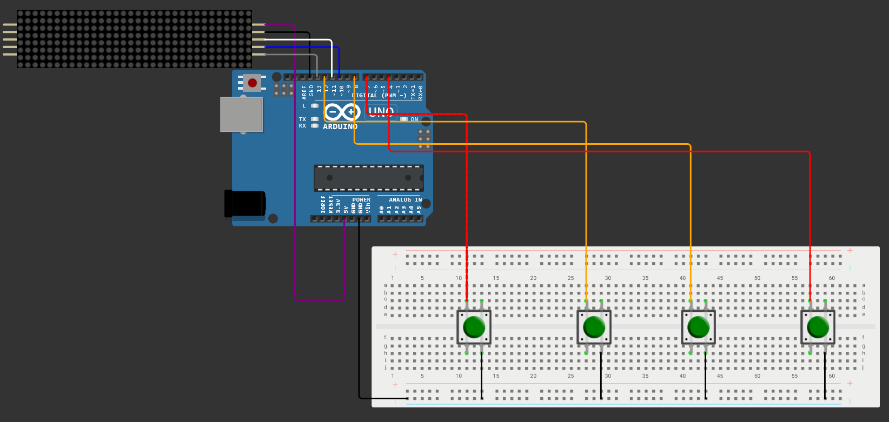
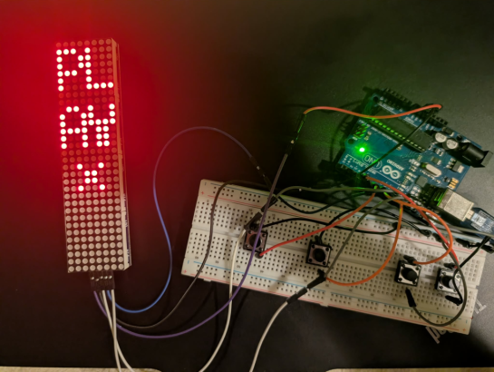
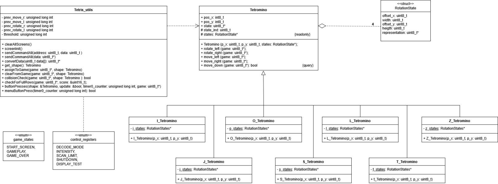

# Objektumorientált Tetris játék AVR-C++ környezetben
*ELTE Beágyazott eszközök (IKSEK-22KVBEEG) félév végi saját projekt.*
## 1. Szinopszis

A projekt célja egy saját fejlesztésű Tetris játékkonzol megtervezése és megvalósítása volt, egy ATmega328P [[1]](#hivatkozások) mikrovezérlő által meghajtott Arduino UNO fejlesztőlapon. A vizuális megjelenítést egy MAX7219-es [[2]](#hivatkozások) kijelzővezérlő IC-vel meghajtott $8 \times 32$-es LED mátrix biztosítja. A program objektumorientált (C++) elveket használ, a játékvezérlés és a darabok logikája külön osztályokba került. A játék állapotai között véges állapotgép (FSM) megvalósításával navigálunk, a gravitációt és a gombok pergésmentesítését hardveres megszakítással (ISR) biztosítjuk.

---

## 2. Áramkör felépítése

### MAX7219 bekötése
* **CLK:** `PIN13` (`PORTB5`)
* **CS:** `PIN10` (`PORTB2`)
* **DIN:** `PIN11` (`PORTB3`)
* **GND:** `GND`
* **VCC:** $5\text{ V}$

### Nyomógombok bekötése (balról jobbra)
* **Gomb (balra mozgatás):** `PIN7` (`PORTD7`)
* **Gomb (jobbra mozgatás):** `PIN12` (`PORTB4`)
* **Gomb (balra forgatás):** `PIN8` (`PORTB0`)
* **Gomb (jobbra forgatás):** `PIN4` (`PORTD4`)

---

## 3. Az elkészült projekt

---

## 4. Szoftver működése

### Osztályok bemutatása

#### `Tetromino`
Egy bázisosztály, melynek célja reprezentálni az összes közös tulajdonságát a Tetris-ben megjelenő alakzatoknak. Ezek:
* Pozíciója a játékfelületen (`pos_x`, `pos_y`)
* A reprezentációja $4$ db $8$ bites számmal (`state`)
* Az összes lehetséges orientáció (`states`)
* Elforgatás (`rotate_left` / `rotate_right`) és mozgatás (`move_left` / `move_right`) elvégzése, amennyiben lehetséges

#### `Tetris_utils`
A játék szimulációjának segédmetódusai és a csak a metódusokhoz tartozó változók:
* `clearAllScreens()`: Az összes $8 \times 8$-as képernyő kikapcsolása.
* `screenInit()`: A MAX7219 kijelző inicializációja. A `control_registers` enumerátor tartalmazza az összes beállítandó (vagy beállítható) regisztert.
* `sendCommandAll(address, data)`: Csak az inicializáció során használt verzió, a $4$ kijelző mindegyikének ugyanazon memóriacímére (`address`) küldi az utasítást (`data`).
* `sendCommandAll(data)`: Egy $32$ hosszúságú, $8$ bites számjegyekből álló tömböt vár, amely reprezentálja az egész kijelzőt: egy szám egy sor, ahol a bitek értéke határozza meg, hogy a pont világít-e vagy nem.
* `convertData()`: Mivel a kijelzőt állítva használjuk és a szoftveres reprezentáció is ezt a tájolást követi, a $32 \times 8$ bitet transzponálni, majd tükrözni kell, hogy a képernyőn is az elvárt módon jelenjen meg a reprezentáció.
* `get_shape()`: Ha egy alakzat megáll, újat generál (pszeudo-random).
* `assignToGame()`: Beleégeti a reprezentációba az alakzat adott helyét, legyen az azért, mert végleg megállt, vagy csak a képfrissítés érdekében.
* `clearFromGame()`: Amint a kép frissült, el kell távolítani az alakzatot a reprezentációból, mivel a helye elavult.
* `collisionCheck()`: Ellenőrzi, hogy az alakzat a jelenlegi helyzetében ütközik-e bármi mással.
* `checkForFullRows()`: Ha egy sor megtelt, eltávolítja, rendezi a reprezentációt és növeli a pontszámot.
* `buttonPresses()`: Ellenőrzi, hogy bármelyik gomb le lett-e nyomva, és elvégzi az alakzaton a módosítást.
* `menuButtonPress()`: Ellenőrzi, hogy bármelyik gomb le lett-e nyomva; ha igen, lépteti a menüt.

### A program állapotai
Az állapotokat a `game_states` enumerátor reprezentálja:
* **`START_SCREEN`**: Ebben az állapotban a kijelzőn a „PLAY” felirat látható és egy gomb kerül kirajzolásra, jelezve a továbblépés módját.
* **`GAMEPLAY`**: A játék futásának állapota, $2$ módja van a kilépésnek:
  1. Megnyerjük a játékot azáltal, hogy végigmegyünk az összes szinten (`levels[]`).
  2. Veszítünk, ha bárhol túllépjük a kijelző méretét.
* **`GAME_OVER`**: Kiírja, hogy „GAME OVER”, gombnyomással újrakezdhetjük a játékot.

### `RotationState`
Egy tetromino összes állapota megjeleníthető $4 \times 4$ darab számmal (a számok bitjei adják a reprezentációt mátrixszerűen). Például:

| Bitek (1) | Bitek (2) | Bitek (3) | Bitek (4) |
| :---: | :---: | :---: | :---: |
| $0$ | $0$ | $0$ | $0$ |
| $1$ | $1$ | $1$ | $1$ |
| $0$ | $0$ | $0$ | $0$ |
| $1$ | $1$ | $1$ | $1$ |

Számokkal: `[0, 15, 0, 0]`  
Az `offset` változók az $y$ és $x$ tengelyeken a valós magasság/szélesség számításában vesznek részt. Ebben az esetben az $y$ offset $1$, mivel az alakzat $y$ pozíciójától számítva $+1$-gyel indul.

### Hardveres megszakítások
A program két beépített megszakítást használ két különböző célra:
* **`TIMER0`**: A gombok pergésmentesítésére használjuk. CTC módban konfigurálva, $8$ biten tartja számon az eltelt időt. Ha a `threshold` által meghatározott idő eltelt, akkor feldolgozzuk a lenyomást.
* **`TIMER1`**: A gravitációt és ezáltal a játék gyorsaságát vezérli. Hasonlóan CTC módban konfigurálva, az `OCR1A` regiszter felülírásával gyorsíthatjuk a játékot.

---

## 5. Összegzés

A projekt célja egy AVR-alapú, hordozható Tetris játékkonzol létrehozása volt, amelyet sikeresen megvalósítottam. A legnagyobb kihívást a hardveres megszakítások (Timerek) és a gombok pergésmentesítésének (debouncing) stabil összehangolása jelentette, amelyet a Timer0 „State + Time” alapú szoftveres algoritmusával oldottam meg. A kód objektumorientált (C++) struktúrája jelentősen megkönnyítette a logikai és megjelenítési rétegek szétválasztását. A jövőbeli továbbfejlesztések között szerepel egy aktív hangszóró integrálása az eredeti hanghatásokhoz.

---

## 6. AI használati napló

**Mesterséges intelligencia használati napló:**
* *„Why are my buttons on my arduino register as being pressed multiple times if i only pressed it once”* [[3]](#hivatkozások)
* *„How to create a constant array type data attribute for a class that gets populated by the constructor in C++ and in an embedded environment”* [[4]](#hivatkozások)

---

## Hivatkozások

| Azonosító | Forrás |
| :--- | :--- |
| **[1]** | Atmel Corporation, *"8-bit AVR Microcontrollers ATmega328/P Datasheet Complete,"* Atmel Corporation, 2016. |
| **[2]** | Analog Devices, *"MAX7219/MAX7221 Serially Interfaced, 8-Digit LED Display Drivers,"* Analog Devices, 2003. |
| **[3]** | Google, *"Google Gemini,"* 08 05 2026. [Online]. Elérhető: https://gemini.google.com/. |
| **[4]** | Google, *"Google Gemini,"* 10 05 2026. [Online]. Elérhető: https://gemini.google.com/. |
